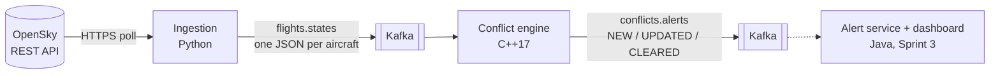

# MiniAir: air traffic conflict detector

[](https://github.com/alishaheb/miniair/actions/workflows/ci.yml)

A small-scale model of a **Short-Term Conflict Alert (STCA)** system, the safety net in Air Traffic Management that warns controllers when two aircraft are about to get too close.

MiniAir reads live ADS-B aircraft positions from the [OpenSky Network](https://opensky-network.org), streams them through **Apache Kafka** to a **C++17** detection engine, and publishes alerts when a pair of aircraft has lost, or will lose within two minutes, the standard separation of **5 NM horizontally and 1,000 ft vertically**.

```
[ALERT] NEW PREDICTED MNA301/MNA302 in 115.0 s, CPA 1.52 NM / 999 ft
[ALERT] NEW PREDICTED MNA101/MNA102 in 119.2 s, CPA 4.85 NM / 0 ft
[ALERT] UPDATED LOSS_OF_SEPARATION MNA301/MNA302 in 0.0 s, CPA 2.70 NM / 875 ft
[ALERT] CLEARED MNA301/MNA302
```

> A learning and portfolio project. It is not certified and must not be used for real air traffic control.

## Highlights

* **C++17 engine** with a pure-logic core (no I/O), built with CMake and strict warnings as errors.
* **89 C++ tests** (GoogleTest + a scenario test) and **41 Python tests** (pytest), also run under AddressSanitizer and UndefinedBehaviorSanitizer.
* **System test in CI**: the whole stack runs in Docker Compose, and the exact expected alerts must come out of Kafka.
* **Safety-critical style**: a documented [MISRA C++ subset](docs/misra-subset.md) with a deviation log, enforced by compiler flags and clang-tidy.
* **Systems engineering**: [requirements with IDs](docs/design.md#2-requirements), UML [component](docs/diagrams/component.svg), [sequence](docs/diagrams/sequence.svg) and [state](docs/diagrams/alert-states.svg) diagrams, and a [test plan with a traceability matrix](docs/test-plan.md#5-traceability-matrix).
* **Tested against real traffic**: live data exposed a false-alert case, which was fixed with regression tests ([details](#findings-from-live-data)).

## Architecture



| Part | Tech | What it does |
|---|---|---|
| [`ingestion/`](ingestion) | Python 3.12, requests, confluent-kafka | Polls OpenSky (OAuth2 or anonymous), converts state vectors, publishes to Kafka. Also runs a synthetic scenario and replays recordings. |
| [`engine/`](engine) | C++17, CMake, librdkafka, nlohmann/json, GoogleTest | Tracks aircraft, predicts conflicts once per surveillance snapshot, manages the alert lifecycle. |
| [`docker-compose.yml`](docker-compose.yml) | Docker, Kafka 3.9 (KRaft) | Runs everything with one command. |
| [`.github/workflows/ci.yml`](.github/workflows/ci.yml) | GitHub Actions | Build, tests, sanitisers, static analysis and system test on every push. |

## Quick start

You only need Docker.

```bash
# Synthetic scenario on a loop: three aircraft pairs with known outcomes
docker compose up --build -d
docker compose logs -f engine        # operator log with [ALERT] lines
make alerts                          # raw JSON from the conflicts.alerts topic

# Live traffic over southern England
MINIAIR_SOURCE=opensky docker compose up --build -d

docker compose down -v
```

Anonymous OpenSky access allows 400 API credits a day, about 3 hours at one poll every 30 s. A free OpenSky account gives 4,000. Copy [`.env.example`](.env.example) to `.env` and add your API client id and secret. `.env` is git-ignored.

Without Docker Compose or Kafka, the two programs can also be piped together:

```bash
make demo   # miniair-ingest --sink stdout | miniair-engine --input stdin
```

## How detection works

Every surveillance snapshot (one OpenSky poll), the engine:

1. moves every aircraft forward to the snapshot time;
2. for each nearby pair, works out the time interval when they will be closer than 5 NM (a quadratic in time) and the interval when they will be closer than 1,000 ft (linear in time);
3. intersects the two intervals with the next 120 s. If that leaves any time, there is a conflict: **loss of separation** if it starts now, otherwise **predicted**;
4. compares the result with the previous cycle and publishes only changes (NEW, UPDATED, CLEARED).

Both minima must be infringed *at the same moment*: an aircraft climbing past another is only in conflict while both gaps are too small. A latitude sweep skips pairs that are too far apart to meet in time, and a test checks this against brute force on 400 aircraft (6 ms). The maths, the timing model and the limitations are in the [design document](docs/design.md#5-conflict-detection-algorithm).

## Testing

```bash
make test          # C++ and Python unit tests
make lint-engine   # clang-tidy
make system-test   # full stack through Kafka, checks the exact alerts
```

| Level | Tool | Count |
|---|---|---|
| C++ unit | GoogleTest | 88 |
| C++ scenario (engine binary, exact alert sequence) | CTest | 1 |
| Python unit | pytest | 41 |
| System (Docker Compose + Kafka) | Bash + Python | 6 expected alert events, and no others |
| Static analysis | clang-tidy, GCC `-Werror`, ruff | 0 findings |
| Dynamic analysis | ASan + UBSan | all C++ tests |

The synthetic scenario is designed so the right answer can be worked out by hand: one crossing pair that conflicts, the same crossing 2,000 ft apart that must **not** alert, and one aircraft climbing through another's level. See the [test plan](docs/test-plan.md).

## Findings from live data

The first live run over southern England (64 aircraft) raised two alerts. Both were *nuisance alerts*, the kind real STCA systems are tuned to suppress:

* **FL390 / FL380 crossing, legally separated.** One aircraft reported +65 ft/min, a single step of ADS-B noise. Extrapolating that for one second made the gap 998.9 ft, just inside the minimum.
  *Fixed:* vertical rates under 150 ft/min now count as level. The first attempt applied this only to the prediction step. Replaying the recorded session showed the alert still fired, because the extrapolation step also used the noisy value. The filter now runs once, where reports enter the engine. Regression tests reproduce the live case.
* **Two aircraft on final approach to Gatwick**, at 1,100 ft and 2,475 ft: normal approach spacing.
  *Backlog:* airport inhibition zones and 3 NM terminal-area minima (Sprint 3).

## Safety-critical practices

* A [MISRA C++ subset](docs/misra-subset.md) of 17 rules, each linked to how it is enforced, plus a deviation log (for example, the one `const_cast` needed by the librdkafka API).
* No exceptions for control flow: external input is parsed in non-throwing mode, and malformed input is rejected and counted, never fatal.
* RAII everywhere, no raw `new`/`delete`, `[[nodiscard]]` on queries, fixed-width integer types.
* Deterministic: time comes from the data, not the wall clock, so a replay gives exactly the same alerts.

## AI-assisted development

This project was built with [Claude Code](https://claude.com/claude-code), Anthropic's AI coding assistant, working in the repository from my project brief (domain, tech stack, sprint scope).

How it was used:

* **Design and code:** Claude Code proposed the architecture and wrote the engine, services, tests and documents in small steps. Each step was built and tested in Docker before moving on.
* **Gates on AI output:** nothing counted as done until the same checks CI runs had passed: `-Werror` builds, clang-tidy, sanitisers, unit, scenario and system tests.
* **Where the checks caught mistakes:**
  * Two first-draft test expectations were wrong: one closest point of approach was beyond the look-ahead window, and one test had a sign error. The tests failed, the reasoning was checked by hand, and the expectations were corrected. The engine was right both times.
  * The first fix for the live-data false alert was incomplete. Replaying the recorded session caught it.
* **Review:** <!-- TODO (Ali): describe your own review here, e.g. which parts you walked through line by line, what you changed, and what you would do differently. -->

## Project management

Work is planned in three sprints with user stories and acceptance criteria in the [backlog](docs/backlog.md), ready to load into GitHub Projects or Jira.

* **Sprint 1, core engine:** done.
* **Sprint 2, integration (Python, Kafka, Docker, CI):** done.
* **Sprint 3, alerting and deployment:** Java alert service and dashboard, AWS deployment (EC2 or ECS), airport inhibition zones, terminal-area minima.

## Repository layout

```
engine/                 C++ conflict detection engine
  include/miniair/      public headers (types, geo, detector, tracks, alerts, codec, engine)
  src/                  implementation + main.cpp (stdin and Kafka modes)
  tests/                GoogleTest suites, scenario fixture, CLI test
ingestion/              Python ingestion service (OpenSky, synthetic, replay)
tests/integration/      Docker Compose system test
docs/                   design, test plan, MISRA subset, backlog, UML diagrams
```

## Data source

Live data from the [OpenSky Network](https://opensky-network.org), used under its terms for research and non-commercial use:

> Matthias Schäfer, Martin Strohmeier, Vincent Lenders, Ivan Martinovic and Matthias Wilhelm. *Bringing Up OpenSky: A Large-scale ADS-B Sensor Network for Research.* IPSN 2014.
