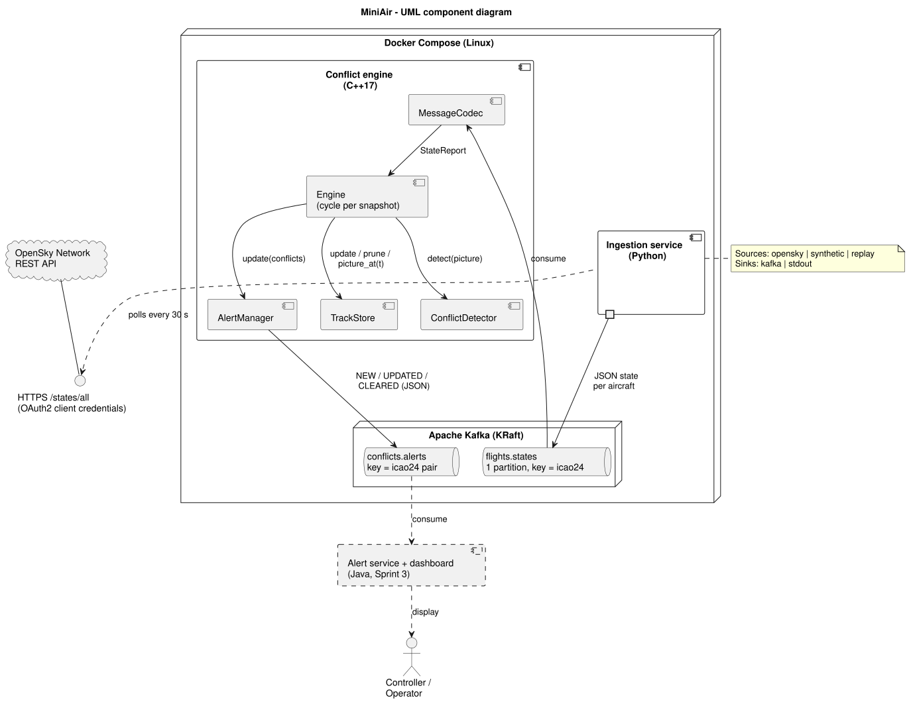
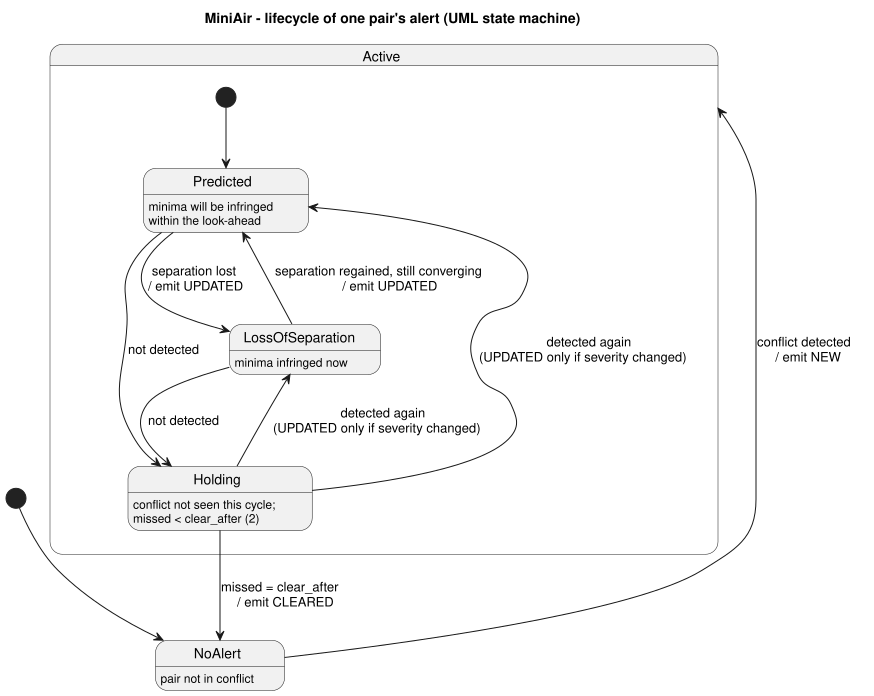

# MiniAir design document

| | |
|---|---|
| Version | 0.1 (end of Sprint 2) |
| Status | Sprints 1 and 2 implemented; Sprint 3 planned |
| Related | [Test plan](test-plan.md) · [MISRA C++ subset](misra-subset.md) · [Backlog](backlog.md) |

## 1. Purpose and scope

MiniAir is a small-scale model of a Short-Term Conflict Alert (STCA) function in an Air Traffic Management (ATM) system. It reads live aircraft surveillance data, predicts where each aircraft will be over the next two minutes, and raises an alert when two aircraft have lost, or will lose, the required separation.

It is a learning and demonstration system. It is **not** certified, is not fit for operational use, and makes simplifying assumptions that are listed in section 9.

## 2. Requirements

Each requirement has an ID so tests can be traced to it (see the traceability matrix in the [test plan](test-plan.md#5-traceability-matrix)).

### 2.1 Functional

| ID | Requirement |
|---|---|
| REQ-F-01 | The system shall read ADS-B state vectors from the OpenSky Network API for a configurable bounding box. |
| REQ-F-02 | Ingestion shall convert each state vector to the `flights.states` message format and drop records missing position, barometric altitude, ground speed or track. |
| REQ-F-03 | Ingestion shall publish one message per aircraft, keyed by ICAO 24-bit address. |
| REQ-F-04 | The engine shall keep the latest state of each aircraft, ignore reports older than the one held, and drop aircraft not reported for longer than a maximum age (default 60 s). |
| REQ-F-05 | The engine shall run one detection cycle per surveillance snapshot, with every aircraft moved forward to the snapshot time. |
| REQ-F-06 | The engine shall report a **loss of separation** when two aircraft are closer than the horizontal minimum (default 5 NM) **and** closer than the vertical minimum (default 1,000 ft) at the same time. |
| REQ-F-07 | The engine shall report a **predicted conflict** when, flying straight at constant speed and vertical rate, a pair will lose separation within the look-ahead time (default 120 s). |
| REQ-F-08 | The engine shall ignore aircraft on the ground or below a minimum altitude (default 1,000 ft). |
| REQ-F-09 | The engine shall raise one NEW event when a conflict starts, an UPDATED event when its severity changes, and a CLEARED event after it has been absent for a set number of cycles (default 2). |
| REQ-F-10 | The engine shall publish alert events as JSON, in nautical miles and feet, to `conflicts.alerts`. |
| REQ-F-11 | Separation minima, look-ahead, minimum altitude and level-flight band shall be configurable without rebuilding. |
| REQ-F-12 | Ingestion shall offer a synthetic scenario with known outcomes, and replay of recorded sessions, for repeatable testing. |

### 2.2 Non-functional

| ID | Requirement |
|---|---|
| REQ-N-01 | Malformed or out-of-range input shall never crash the engine. It shall be rejected and counted. |
| REQ-N-02 | The engine shall not use exceptions for control flow. Parsing shall not throw. |
| REQ-N-03 | The same input shall always produce the same alerts (time is taken from the data, not the wall clock). |
| REQ-N-04 | A detection cycle for 400 aircraft shall complete well within the 5 s update interval. |
| REQ-N-05 | Services shall shut down cleanly on SIGTERM, flushing Kafka. |
| REQ-N-06 | Ingestion shall survive network errors and API rate limits, retrying with back-off. |
| REQ-N-07 | Credentials shall not appear in code, images or config files; they are read from environment variables only. |
| REQ-N-08 | The whole system shall run on Linux containers, started with one command. |
| REQ-N-09 | Vertical-rate noise from ADS-B shall not cause false alerts between aircraft at standard 1,000 ft separation. |

## 3. Architecture



| Component | Language | Responsibility |
|---|---|---|
| Ingestion service | Python 3.12 | Polls OpenSky (OAuth2 or anonymous), normalises state vectors, publishes to Kafka. Also runs the synthetic scenario and replays recordings. |
| Kafka (KRaft, single broker) | - | Decouples producers from the engine and keeps a replayable log of traffic and alerts. |
| Conflict engine | C++17 | Tracks aircraft, runs conflict detection each cycle, manages the alert lifecycle, publishes alerts. |
| Alert service and dashboard | Java (Sprint 3) | Consumes alerts and shows them to an operator. |

The C++ engine is split into a pure-logic library (`miniair_core`, no I/O, no Kafka) and a thin executable. Everything that matters for safety can therefore be unit tested without a broker, and the executable can also run as a Unix filter (stdin to stdout).

| Class | Responsibility |
|---|---|
| `MessageCodec` | Parses and validates `flights.states` JSON without throwing; writes alert JSON. |
| `TrackStore` | Latest state per aircraft; rejects out-of-order reports; prunes stale tracks; extrapolates the picture to a common time. |
| `ConflictDetector` | Pure geometry: finds conflicting pairs in a picture. |
| `AlertManager` | Turns each cycle's conflicts into NEW / UPDATED / CLEARED events. |
| `Engine` | Snapshot-driven cycle control; applies the level-flight band to incoming reports. |
| `KafkaConsumer` / `KafkaProducer` | RAII wrappers over librdkafka with error returns. |

## 4. Interfaces

### 4.1 `flights.states` (ingestion to engine)

One JSON object per aircraft per snapshot, SI units. Key: `icao24`.

```json
{"icao24": "4ca7b5", "callsign": "RYR12AB", "t": 1730000005.0, "snapshot": 1730000010.0,
 "lat": 51.47, "lon": -0.45, "alt_m": 10668.0, "gs_mps": 230.5, "track_deg": 95.0,
 "vr_mps": 0.0, "on_ground": false, "source": "opensky"}
```

| Field | Meaning |
|---|---|
| `t` | When the position was measured (Unix seconds) |
| `snapshot` | Time of the surveillance picture (one OpenSky poll); drives the detection cycle |
| `alt_m` | **Barometric** altitude. Flight levels are pressure altitudes, so GPS altitude is never mixed in. |
| `vr_mps` | Vertical rate; `null` from OpenSky is sent as `0` (level) |

### 4.2 `conflicts.alerts` (engine to consumers)

Aviation units, for people. Key: `"<icao24_a>|<icao24_b>"`, so all events for one conflict stay in order.

```json
{"event": "NEW", "severity": "PREDICTED", "cycle_time": 1700000070.0,
 "icao24_a": "4d0101", "callsign_a": "MNA101", "icao24_b": "4d0102", "callsign_b": "MNA102",
 "time_to_conflict_s": 119.2, "cpa_time_s": 120.0, "cpa_horizontal_nm": 4.85, "cpa_vertical_ft": 0.0,
 "current_horizontal_nm": 25.93, "current_vertical_ft": 0.0}
```

### 4.3 Kafka topic design

* `flights.states` has **one partition**. Conflict detection needs the whole traffic picture, in order. Kafka only orders messages within a partition, so splitting by aircraft would break the snapshot boundaries the engine relies on. A real system scales by airspace sector (one topic and one engine per sector), not by aircraft.
* Messages are still keyed by ICAO address, so per-aircraft ordering survives if partitions are added later.
* Topics are created explicitly by the `kafka-init` service; auto-creation is off.

## 5. Conflict detection algorithm

### 5.1 Coordinates

For each pair, positions are projected onto a flat plane tangent at the pair's mid-latitude (x east, y north). At the ranges that matter here (under 100 km) this agrees with the great-circle (haversine) distance to better than 0.1%; a unit test checks this.

### 5.2 Conflict window

Take aircraft A and B at the same time. Let **r** be B's position relative to A, **v** the relative velocity, *dz* the altitude difference and *dvz* the relative vertical rate. The pair is horizontally too close while

&nbsp;&nbsp;&nbsp;&nbsp;|**r** + **v**t|² < H², that is (**v**·**v**)t² + 2(**r**·**v**)t + (**r**·**r** − H²) < 0

which is a quadratic in *t*, giving an interval (or none). The pair is vertically too close while |dz + dvz·t| < V, a linear interval. The **conflict window** is the intersection of the horizontal interval, the vertical interval and [0, look-ahead].

* Empty window: no conflict.
* Window starts at 0 and the pair is inside both minima now: **loss of separation**.
* Otherwise: **predicted conflict**, with time to conflict = start of the window.

Requiring both minima *at the same moment* matters. A climbing aircraft may pass horizontally close to another while still well below it, and that is safe. The climb-through unit test covers this case.

The closest point of approach (CPA) is reported inside the conflict window, so it never refers to a time beyond the look-ahead.

### 5.3 Pair search

A naive check of every pair is O(n²). The detector sorts aircraft by latitude and, for each aircraft, stops scanning once the north-south gap exceeds

&nbsp;&nbsp;&nbsp;&nbsp;reach = H + 2 · v_max · look-ahead

because two aircraft cannot close faster than twice the fastest ground speed. A cheap vertical filter skips pairs that cannot get within V during the look-ahead. A property test on 400 random aircraft checks that the sweep finds exactly the same conflicts as brute force.

### 5.4 Data quality rules

| Rule | Why |
|---|---|
| 1 ft margin on the vertical minimum | Altitudes arrive in 25 ft steps converted to metres. Without the margin, two aircraft exactly 1,000 ft apart (FL380 / FL390, a legal everyday case) compute as 999.99 ft and raise a false alert. Confirmed in live data. |
| Level-flight band: vertical rate under 150 ft/min counts as level | ADS-B reports vertical rate in 64 ft/min steps and level aircraft often show one or two steps of noise. Applied once, when reports enter the engine, so extrapolation and prediction use the same cleaned value. Found with live data (section 8). |
| Out-of-order reports are ignored | A late report must not move an aircraft backwards. |
| The engine clock never goes backwards | A late report from an old snapshot updates its track but does not trigger a cycle at an earlier time. |

## 6. Timing model

The engine runs a cycle when a snapshot is complete. It knows a snapshot is complete when either:

1. a report from a **newer** snapshot arrives, or
2. no message has arrived for 500 ms (Kafka mode only), so a snapshot is not left waiting for the next poll.

Cycle time is the snapshot time from the data, not the wall clock. Replaying a recording gives exactly the same alerts as the live run (REQ-N-03), and the system test can check alert timings to the second.

## 7. Alert lifecycle



A conflict must be missing for `clear_after` cycles in a row (default 2) before it is cleared. This stops alerts flickering on and off when a pair sits on the edge of the minima.

The full flow of one cycle is shown in the [sequence diagram](diagrams/sequence.svg).

## 8. Findings from live data

The first run against live OpenSky traffic over southern England (64 aircraft) raised two alerts. Both were nuisance alerts of the kinds real STCA systems are tuned to suppress:

| Pair | What happened | Action |
|---|---|---|
| FPO9NN / AFR57UD | FL390 and FL380 crossing, legally separated. AFR57UD reported +65 ft/min, one ADS-B step of noise. One second of extrapolation took the gap to 998.9 ft. | **Fixed**: level-flight band (REQ-N-09), with engine-level regression tests reproducing the case. A first fix applied the band only in prediction. Replaying the recorded session showed the alert was still raised, because extrapolation used the noisy rate too. The band now applies at input. |
| TOM443 / EZY14YA | Both on final approach to Gatwick runway 26 at 1,100 ft and 2,475 ft: normal approach spacing. | **Backlog**: airport inhibition zones and terminal-area (3 NM) minima, as real systems use (Sprint 3). |

## 9. Assumptions and limitations

* Straight-line, constant-rate prediction. Turns are not predicted, so alerts for turning aircraft can be late or false.
* One set of minima everywhere. Real systems use 3 NM in terminal areas and inhibit alerts near runways.
* OpenSky positions can be several seconds old and are not smoothed by a tracker (no Kalman filter).
* No aircraft intent (flight plan, cleared level) is used.
* Single Kafka broker, no replication: suitable for a demonstration only.
* Coverage depends on OpenSky's volunteer receivers; some aircraft are missing or have gaps.

## 10. Configuration

| Engine flag | Default | Meaning |
|---|---|---|
| `--horizontal-nm` | 5 | Horizontal separation minimum |
| `--vertical-ft` | 1000 | Vertical separation minimum |
| `--look-ahead-s` | 120 | Prediction horizon |
| `--min-altitude-ft` | 1000 | Ignore traffic below this |
| `--level-flight-fpm` | 150 | Vertical rates below this count as level |
| `--max-track-age-s` | 60 | Drop tracks not updated for this long |
| `--clear-after` | 2 | Conflict-free cycles before CLEARED |
| `--idle-flush-ms` | 500 | Quiet time that completes a snapshot (Kafka mode) |

Ingestion settings are environment variables; see [`.env.example`](../.env.example).
